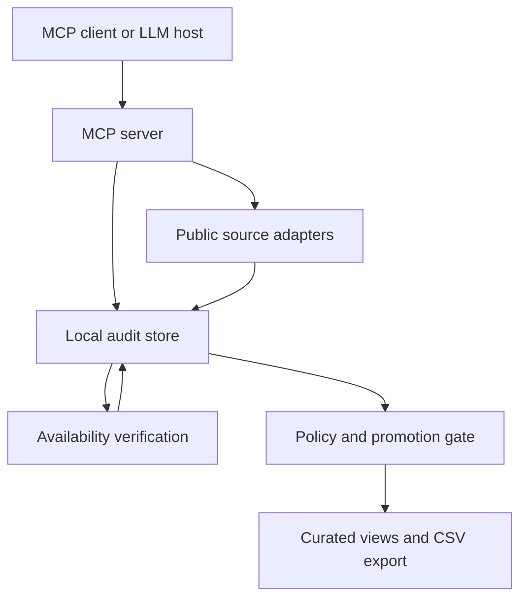

# Architecture

The useful separation is between **finding a URL**, **proving its application state**, and **deciding it belongs in a curated view**. Those are different operations and produce different evidence.

## Capabilities

| Primitive | Name | Responsibility |
| --- | --- | --- |
| Tool | `list_sources` | Return source IDs, capabilities and limitations |
| Tool | `search_jobs` | Fetch a supported board by source ID, audit all surfaced specific posts, then return a filtered view |
| Tool | Configured source search tools | One tool per enabled Greenhouse/Lever source; name is configured or derived from source ID |
| Tool | `filter_jobs` | Query the already-captured audit; never discover new jobs |
| Tool | `import_hits` | Capture specific URLs from outside discovery; no user-field overwrite |
| Tool | `check_posting` | Recheck one exact posting and append availability evidence/history |
| Tool | `get_recheck_queue` | Return due work, prioritizing the active workflow |
| Tool | `promote_job` | Apply fresh-Open and policy gates, then add or update a curated entry |
| Tool | `export_jobs` | Return CSV content; does not write an arbitrary server-side file |
| Resource | `jobboards://catalog` | Read-only source catalog |
| Resource template | `jobboard://{source_id}` | One source's configuration and supported behavior |
| Resource | `jobs://audit` | Read-only current audit snapshot |
| Resource | `policy://profile` | The configured search/promotion profile |
| Prompt | `discovery_queries` | Generate title/location/source query instructions |
| Prompt | `run_job_check` | Return the portable capture/check/assess/report workflow |
| Prompt | `assess_job` | Guide evidence-based technical, cultural and practical assessment |
| Prompt | `report_changes` | Guide a concise delta report rather than repeating unchanged leads |

Resources do not automatically load websites. A host chooses whether to read a
resource. A model or client chooses whether to call a tool. A person or host
selects a prompt. This package exposes importable client/server classes and
does not include a command-line launcher.

## Evidence and state

| State | Meaning | Curated promotion |
| --- | --- | --- |
| `Unclear` | Current acceptance has not been established | Denied |
| `Open` | A supported exact application path or employer-requisition evidence was verified | Allowed only while fresh and policy-eligible |
| `Closed` | Closure text, removed/generic redirect, expired deadline or supported employer evidence confirms closure | Denied |

A fresh check means no older than 24 hours at promotion time. Fetch errors, blocked pages and unsupported hosts remain `Unclear`, not `Open`. Reopening needs fresh positive evidence; cached text is insufficient.

Raw records retain all URLs surfaced. Canonicalization removes known tracking-only parameters rather than stripping every query string: `jk`, requisition identifiers and similar job-defining fields must survive. URL aliases are kept for auditability and should not create duplicate curated recommendations.

The audit's availability history and curated warning/visibility state are separate from the user-owned application status and notes. A closure must not turn an `applied` decision into `no` or delete its history.

## Runtime responsibilities

The server is the policy/data boundary. It performs source access, persistence, checks and promotion validation. The client is a transport/application boundary. It discovers capabilities, sends arguments and displays results.

Neither is a scheduler. An external scheduler may invoke a deterministic CLI workflow or an LLM host may orchestrate the returned monitor prompt. The three-day discovery window and recheck queue remain useful outside ChatGPT, but must be run by an actual host/job runner.

The server has no application-submission capability. GET-only network access is deliberate. A candidate remains responsible for evaluating a role and applying through the employer's normal channel.
